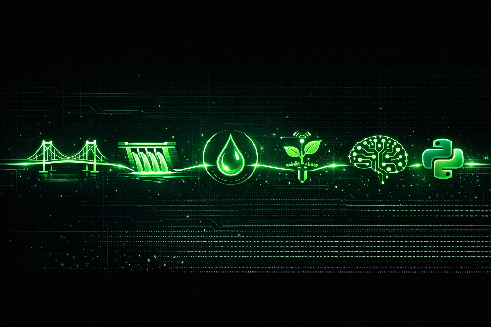

# Alireza Sani

**Engineering software · Water and environment · Earth observation**

I build practical software tools for water and environmental engineering, geospatial analysis, and Earth observation. My work combines engineering calculations, data workflows, and accessible interfaces, with clear notes on what is measured, simulated, and still experimental.

## Selected work

### Water Network Optimizer
A Python toolkit and command-line tool for pressurized pipe sizing, velocity checks, and Hazen–Williams head-loss calculations.

[Repository](https://github.com/fazeli1977-dot/water-network-optimizer)

### Water Sampling App
A Persian, right-to-left workflow for water and wastewater sampling, geotagged records, lab-result comparisons, and PDF reports. The compliance checks are indicative and do not replace official laboratory or regulatory determinations.

[Repository](https://github.com/fazeli1977-dot/water-sampling-app)

### SAR-MotionLens
An interactive SAR/InSAR demonstration with real NISAR granule metadata queried from ASF DAAC. **Deformation, interferogram, time-series, and machine-learning outputs are simulations—not satellite-derived measurements.**

[Live demo](https://sar-motionlens.streamlit.app/) · [Repository](https://github.com/fazeli1977-dot/SAR-MotionLens)

## Other work

- [ClimateLens](https://github.com/fazeli1977-dot/ClimateLens) — exploratory climate-risk and trend-analysis prototype. Risk scores are heuristic; the trend series is synthetic, and the risk workflow may use synthetic fallback data when NASA POWER is unavailable.
- [FireSync MODIS–VIIRS](https://github.com/fazeli1977-dot/FireSync-MODIS-VIIRS) — a wildfire-observation harmonization project; the dashboard's sample detections are synthetic, and live FIRMS ingestion has not been demonstrated.
- [All public repositories](https://github.com/fazeli1977-dot?tab=repositories)

## Focus and tools

Water systems and environmental monitoring · Hydrology · Python · Streamlit · FastAPI · Data processing · GIS and remote sensing · Climate and Earth-observation data · Testing and reproducible workflows

## Collaboration

Open to international collaborations and software work in engineering, water infrastructure, environmental data, and Earth observation. Typical work includes Python tools, dashboards, data workflows, and decision-support prototypes.

## Contact

[Email](mailto:alirezafazeli@live.com) · [GitHub](https://github.com/fazeli1977-dot)
